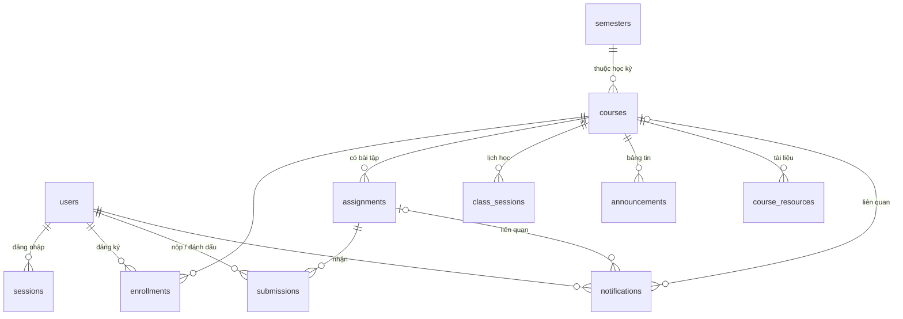

# Moodle USTH Mobile App — Chức năng & Cơ sở dữ liệu

Tài liệu mô tả toàn bộ chức năng của ứng dụng (app Android + backend) và cấu trúc cơ sở dữ liệu.
Chi tiết cách chạy backend và danh sách endpoint xem thêm `backend/README.md`.

---

## 1. Tổng quan

| Thành phần | Công nghệ | Thư mục |
|---|---|---|
| App Android | Kotlin, Jetpack Compose, Material 3, MVVM (`MainViewModel`) | `app/` |
| Backend REST API | Node.js ≥ 22.13, `node:http`, `node:sqlite` (không cần `npm install`) | `backend/` |
| Cơ sở dữ liệu | SQLite, file `backend/data/moodle-usth.db` | tự tạo khi chạy lần đầu |
| Bản thiết kế gốc | Figma Make (React) trong `D:\assetmobileapp\EdTech Mobile App Design.zip` | — |

Luồng dữ liệu:

```
App (Compose UI) ──► MainViewModel ──► MoodleRepository ──► MoodleApi (HTTP/JSON) ──► Backend ──► SQLite
                          ▲                   │
                          │                   ├─ SessionStore: token, địa chỉ server, cache bootstrap (offline)
                     LearningRules            └─ assets/sample_bootstrap.json (chế độ xem thử)
             (trạng thái/tiến độ theo đồng hồ)
```

- App mở lên gọi **một** endpoint `GET /api/v1/bootstrap` để lấy toàn bộ dữ liệu, rồi tự tính lại trạng thái
  (sắp hạn, quá hạn, tiến độ) theo đồng hồ thiết bị mỗi 30 giây bằng `LearningRules` (cùng quy tắc với backend).
- Thao tác ghi (đánh dấu hoàn thành, đọc thông báo) gọi API riêng và cập nhật state cục bộ ngay.

### Chạy nhanh

```bash
cd backend && npm start            # http://localhost:8080, tự seed dữ liệu lần đầu
npm run reset                      # seed lại (deadline tính lại theo thời điểm hiện tại)
```

Mở app trên emulator (mặc định gọi `http://10.0.2.2:8080`). Tài khoản demo: `BA22-041 / usth2025`, `BA22-087 / usth2025`.

---

## 2. Chức năng của app

### 2.1. Đăng nhập & phiên làm việc

| Chức năng | Mô tả |
|---|---|
| Đăng nhập | Nhập mã sinh viên + mật khẩu → `POST /auth/login`, nhận token (hạn 30 ngày), lưu trong SharedPreferences. Mã SV không phân biệt hoa/thường. |
| Đổi địa chỉ máy chủ | Mục "Máy chủ" trên màn đăng nhập, dùng khi chạy trên điện thoại thật qua Wi‑Fi (VD `http://192.168.1.10:8080`). |
| Quyền mạng cục bộ | Android 17+ (API 37) bắt buộc quyền `ACCESS_LOCAL_NETWORK` để gọi địa chỉ LAN/emulator; app xin quyền khi bấm *Đăng nhập*. |
| Giữ phiên | Mở lại app vào thẳng màn chính. Token hết hạn/không hợp lệ (401) → về màn đăng nhập kèm thông báo. |
| Xem thử (demo) | Nút "Xem thử với dữ liệu mẫu": dùng `assets/sample_bootstrap.json`, mọi mốc thời gian được dời theo giờ hiện tại; đánh dấu hoàn thành chỉ lưu tạm trong bộ nhớ. Có banner vàng báo chế độ xem thử. |
| Ngoại tuyến | Mỗi lần tải thành công, bootstrap được cache vào file. Mất mạng → hiển thị bản cache + banner đỏ "Ngoại tuyến · chạm để thử lại". Chưa có cache → màn lỗi với nút *Thử lại* / *Đăng xuất*. |
| Làm mới | Kéo xuống (pull-to-refresh) ở mọi màn hình chính. |
| Đăng xuất | Ở Profile, có hộp thoại xác nhận; xoá token, cache và gọi `POST /auth/logout`. |

### 2.2. Home

- **Header**: avatar (chữ viết tắt), lời chào theo tên, chuông thông báo kèm số bài *sắp hạn* (≤ 24h hoặc quá hạn).
- **Your study space**: 3 ô *To do* (bài chưa xong), *Due soon* (sắp hạn), *Recent done* (xong trong 14 ngày). Chạm → mở danh sách bài tập với bộ lọc tương ứng.
- **Your next deadline**: bài chưa xong có hạn gần nhất với đồng hồ đếm ngược giờ:phút:giây chạy từng giây; badge *Due within 24h / Coming up / Overdue*; hết bài → "All caught up". Link "View task" mở chi tiết bài.
- **Up next**: 2 bài sắp đến hạn tiếp theo + "All assignments".
- **Your courses**: thẻ môn học (ảnh, mã môn, tín chỉ, giảng viên, thanh tiến độ, số bài đã xong / còn lại). Chạm → chi tiết môn.

### 2.3. Courses

- Học kỳ hiện tại (lấy từ server), lối tắt *To do* / *Due soon* kèm số lượng, tổng tín chỉ đang học.
- Danh sách thẻ môn học; nút lịch ở góc phải mở **Weekly planner** (tất cả deadline chưa xong theo thứ tự hạn nộp).

### 2.4. Chi tiết môn học

Header có nút quay lại (về đúng tab đã mở trước đó) và nút "…" mở **Course information**.
Phần đầu: ảnh môn, mã môn, giảng viên, vòng tiến độ %, số bài còn lại / đã xong / tín chỉ. Ba tab:

| Tab | Nội dung |
|---|---|
| **Stream** | "Your next steps" (2 bài sắp hạn của môn), bảng tin giảng viên: thông báo được ghim, thông báo tài liệu mới kèm nút "View course resources". |
| **Classwork** | Thẻ "Know what counts" (Attendance 10% · Mid-term & labs 30% · Final project 60%); bài tập nhóm theo thành phần điểm, mỗi nhóm thu gọn/mở rộng được, hiện số bài đã xong; bài đã chấm hiện điểm `x.x/10`. |
| **Grade Weights** | Trọng số chi tiết và trạng thái từng thành phần (*đã chấm / đang chấm · điểm hiện tại / chưa chấm*), điểm tích luỹ của môn, link sang báo cáo điểm. |

**Course information**: ảnh, mô tả môn, lịch học hằng tuần (thứ, giờ, phòng), nút "Xem thời khóa biểu", danh sách **tài liệu môn học** theo tuần (slide, ghi chú, bài tập, dữ liệu; định dạng và dung lượng).

### 2.5. Chi tiết bài tập (dialog)

- Trạng thái (*Upcoming / Due within 24 hours / Overdue / Completed*), môn học, thời gian còn lại + hạn nộp, % đóng góp.
- Mô tả bài; nếu đã chấm: điểm và nhận xét của giảng viên.
- "How this task counts": thuộc thành phần nào (và trọng số), % đóng góp vào điểm môn, số tín chỉ, điểm tối đa có thể cộng (`contribution / 10`).
- Ghi chú "Course weight is not GPA weight".
- Nút **Mark as done** → `POST /assignments/:id/completion`; sau đó đổi thành **Undo** (`DELETE …`). Bài đã chấm điểm không thể bỏ đánh dấu (server trả 409).
- Thông báo kết quả (VD "Molecular Biology: 78% complete · 2 tasks left") hiển thị ngay trong dialog.

### 2.6. Danh sách bài tập "My classwork" (dialog)

- Tab trạng thái *To do / Due soon / Done* kèm số lượng; lọc theo môn ("All classes" hoặc từng môn).
- Tab *Done* chia "Gần đây · 14 ngày" (khớp với ô *Recent done* ở Home) và "Trước đó", sắp xếp mới nhất trước.
- Trạng thái rỗng có lời nhắn riêng cho từng tab.

### 2.7. Thời khóa biểu (Lịch học)

- **Chế độ Tuần**: dải 7 ngày T2 → CN của tuần đang chọn, chấm báo ngày có lịch, viền cho hôm nay; mũi tên chuyển tuần.
- **Chế độ Tháng**: lưới tháng (T2 → CN), mỗi ngày có chấm màu theo môn học, ngày ngoài tháng được làm mờ, chú thích màu theo mã môn; mũi tên chuyển tháng.
- **Tổng quan**: nhãn *Tuần này / Tuần đã chọn / Tháng này / Tháng đã chọn*, khoảng ngày, tổng số buổi và tổng giờ học của kỳ đang xem.
- **Lịch trong ngày**: số buổi + tổng giờ; mỗi buổi có giờ bắt đầu/kết thúc, thời lượng, loại (Lý thuyết/Thực hành), phòng, giảng viên và trạng thái *Đang diễn ra / Sắp tới / Đã kết thúc*. Chạm → chi tiết môn.
- Ngày không có lịch: thẻ "Một chút thời gian cho chính mình" + nút nhảy tới ngày gần nhất có lịch.
- Nút **Hôm nay** (vô hiệu khi đang xem hôm nay). Lịch chỉ hiển thị trong khoảng thời gian học kỳ.

### 2.8. Tracker (tiến độ)

- Bộ chọn học kỳ → **Semester overview** (tín chỉ đạt được, số bài đã xong).
- Thẻ tín chỉ: `credits_earned / credits_milestone`, thanh tiến độ, số tín chỉ còn thiếu.
- **Overall completion** (% bài đã xong trên tổng, badge *On track* hoặc số bài sắp hạn) và **Average grade** (trung bình điểm môn theo tín chỉ).
- **Subject breakdown**: từng môn với số bài xong, điểm tích luỹ, thanh tiến độ; chạm → chi tiết môn.
- Nút tải về → **Grade report**: điểm từng môn + nút tải **CSV** (`GET /reports/grades.csv`), lưu vào thư mục *Download* của máy.

### 2.9. Profile

- Thẻ sinh viên (họ tên, khoá, ngành), thông tin: mã SV, năm học, học kỳ.
- Lối tắt "My academic progress" → Tracker.
- Trạng thái kết nối: *Đã đồng bộ* (kèm địa chỉ server) / *Đang ngoại tuyến* / *Chế độ xem thử*.
- Đăng xuất (có xác nhận).

### 2.10. Thông báo (dialog từ chuông)

- *Deadline reminders*: các bài sắp hạn/quá hạn.
- *Course progress*: % hoàn thành từng môn; chạm → chi tiết môn.
- *From your classroom*: thông báo từ server (điểm mới, tin nhắn giảng viên), chấm đỏ = chưa đọc; chạm → đánh dấu đã đọc và mở bài tập / thông tin môn liên quan.

---

## 3. Quy tắc nghiệp vụ

| Quy tắc | Định nghĩa | Cài đặt |
|---|---|---|
| Trạng thái bài | Có submission → `DONE`; `due_at ≤ now` → `OVERDUE`; còn ≤ 24h → `URGENT`; còn lại `UPCOMING` | `services.js#assignmentStatus`, `LearningRules.status` |
| "Due soon" | `URGENT` hoặc `OVERDUE` | cả hai phía |
| "Recent done" | Hoàn thành trong 14 ngày gần nhất | `learningSummary`, `LearningRules.summary` |
| Thời gian còn lại | `< 60 phút` → "N min left"; `< 24h` → "Hh Mm left"; còn lại "N days left" (làm tròn lên) | `LearningRules.timeRemaining` |
| Tiến độ môn | `done / total` số bài của môn (làm tròn %) | `toCourse`, `LearningRules.courseWithProgress` |
| Thành phần điểm | `ATTENDANCE` 10%, `MIDTERM_LABS` 30%, `FINAL_PROJECT` 60% | `CATEGORIES`, `AssignmentCategory` |
| % đóng góp bài | Cột `assignments.contribution` (VD proposal 15, mỗi buổi điểm danh 1) | — |
| Điểm thành phần | TB có trọng số (`contribution`) của bài đã chấm trong thành phần. `GRADED` khi tổng trọng số đã chấm ≥ trọng số thành phần, `IN_PROGRESS` nếu đã chấm một phần, `NOT_GRADED` nếu chưa | `gradeComponents` |
| Điểm tích luỹ môn | `Σ(score × contribution) / Σ(contribution)` trên các bài đã chấm, làm tròn 1 chữ số | `gradeOf` |
| Điểm TB học kỳ | TB điểm môn có trọng số theo tín chỉ (bỏ môn chưa có điểm) | `semesterOverview` |
| Bỏ đánh dấu | Chỉ khi bài chưa có điểm (`score IS NULL`), ngược lại 409 `already_graded` | `unmarkCompleted` |
| Lịch học | Lặp hằng tuần theo `weekday`, chỉ trong `[semesters.starts_at, ends_at]` | `TimetableScreen` |

---

## 4. Cơ sở dữ liệu

SQLite, bật `PRAGMA foreign_keys = ON` và `journal_mode = WAL`. Schema định nghĩa trong `backend/src/db.js`,
dữ liệu mẫu trong `backend/src/seed.js`. Mọi mốc thời gian là **epoch milliseconds** (INTEGER).

### 4.1. Sơ đồ quan hệ



### 4.2. Các bảng

#### `meta` — thông tin hệ thống
| Cột | Kiểu | Ràng buộc | Ý nghĩa |
|---|---|---|---|
| key | TEXT | PK | Tên khoá (hiện có `seeded_at`) |
| value | TEXT | NOT NULL | Giá trị (thời điểm seed, dùng để cảnh báo dữ liệu cũ) |

#### `users` — sinh viên
| Cột | Kiểu | Ràng buộc | Ý nghĩa |
|---|---|---|---|
| id | INTEGER | PK | Khoá tự tăng |
| username | TEXT | NOT NULL, UNIQUE | Tên đăng nhập = mã SV viết thường (`ba22-041`) |
| password_hash | TEXT | NOT NULL | `salt:hash` dùng **scrypt** (32 byte), so sánh bằng `timingSafeEqual` |
| full_name | TEXT | NOT NULL | Họ tên đầy đủ |
| short_name | TEXT | NOT NULL | Tên gọi trong lời chào ("An") |
| initials | TEXT | NOT NULL | Chữ viết tắt cho avatar ("HA") |
| student_id | TEXT | NOT NULL | Mã SV hiển thị ("BA22-041") |
| program | TEXT | NOT NULL | Ngành học |
| cohort | TEXT | NOT NULL | Khoá ("USTH · Class of 2026") |
| credits_earned | INTEGER | NOT NULL | Số tín chỉ đã tích luỹ |
| credits_milestone | INTEGER | NOT NULL | Mốc tín chỉ tiếp theo (thẻ tín chỉ ở Tracker) |

#### `sessions` — phiên đăng nhập
| Cột | Kiểu | Ràng buộc | Ý nghĩa |
|---|---|---|---|
| token | TEXT | PK | Token ngẫu nhiên 32 byte (base64url), gửi qua `Authorization: Bearer` |
| user_id | INTEGER | FK → users.id, CASCADE | Chủ phiên |
| created_at | INTEGER | NOT NULL | Thời điểm tạo |
| expires_at | INTEGER | NOT NULL | Hết hạn sau 30 ngày |

#### `semesters` — học kỳ
| Cột | Kiểu | Ràng buộc | Ý nghĩa |
|---|---|---|---|
| id | TEXT | PK | VD `2026–2027-semester-1` |
| label | TEXT | NOT NULL | "Semester 1" / "Semester 2" (kỳ 1: tháng 9–1, kỳ 2: tháng 2–7) |
| academic_year | TEXT | NOT NULL | "2026–2027" |
| starts_at | INTEGER | NOT NULL | Ngày bắt đầu (giới hạn hiển thị lịch học) |
| ends_at | INTEGER | NOT NULL | Ngày kết thúc |

Học kỳ hiện tại = bản ghi có `starts_at` lớn nhất.

#### `courses` — môn học
| Cột | Kiểu | Ràng buộc | Ý nghĩa |
|---|---|---|---|
| id | TEXT | PK | `web`, `bio`, `earth` |
| semester_id | TEXT | FK → semesters.id | Học kỳ mở môn |
| title / short_title | TEXT | NOT NULL | Tên đầy đủ / tên ngắn |
| code | TEXT | NOT NULL | Mã môn ("ICT 3103") |
| teacher / teacher_initials | TEXT | NOT NULL | Giảng viên phụ trách |
| image | TEXT | NOT NULL | Tên ảnh drawable trong app (`development`, `biology`, `earth`) |
| credits | INTEGER | NOT NULL | Số tín chỉ |
| tone | TEXT | NOT NULL | Màu chủ đạo trên UI (`blue`, `green`, `purple`) |
| summary | TEXT | NOT NULL | Mô tả môn |

#### `enrollments` — đăng ký môn (n‑n users ↔ courses)
| Cột | Kiểu | Ràng buộc | Ý nghĩa |
|---|---|---|---|
| user_id | INTEGER | PK, FK → users.id | |
| course_id | TEXT | PK, FK → courses.id | |

Mọi truy vấn môn/bài tập/lịch đều JOIN bảng này nên sinh viên chỉ thấy môn mình học (môn khác trả 404).

#### `assignments` — bài tập / hoạt động có tính điểm
| Cột | Kiểu | Ràng buộc | Ý nghĩa |
|---|---|---|---|
| id | TEXT | PK | `proposal`, `lab3`, `web-checkin-1`… |
| course_id | TEXT | FK → courses.id, CASCADE | Môn học |
| title | TEXT | NOT NULL | Tiêu đề |
| category | TEXT | CHECK IN (`ATTENDANCE`, `MIDTERM_LABS`, `FINAL_PROJECT`) | Thành phần điểm |
| contribution | INTEGER | NOT NULL | % đóng góp vào điểm môn |
| description | TEXT | NOT NULL | Hướng dẫn |
| due_at | INTEGER | NOT NULL | Hạn nộp |

#### `submissions` — trạng thái của từng sinh viên với từng bài
| Cột | Kiểu | Ràng buộc | Ý nghĩa |
|---|---|---|---|
| user_id | INTEGER | PK, FK → users.id | |
| assignment_id | TEXT | PK, FK → assignments.id | |
| completed_at | INTEGER | NOT NULL | Thời điểm đánh dấu hoàn thành / nộp |
| score | REAL | NULL | Điểm /10; NULL = chưa chấm |
| feedback | TEXT | NULL | Nhận xét giảng viên |

Có bản ghi = bài đã hoàn thành. *Mark as done* chèn bản ghi (score NULL); *Undo* xoá bản ghi (chỉ khi chưa có điểm).

#### `class_sessions` — lịch học hằng tuần
| Cột | Kiểu | Ràng buộc | Ý nghĩa |
|---|---|---|---|
| id | TEXT | PK | `web-lecture`, `bio-lab`… |
| course_id | TEXT | FK → courses.id, CASCADE | |
| weekday | INTEGER | CHECK 0–6 | 0 = Chủ nhật, 1 = Thứ hai … 6 = Thứ bảy |
| start_time / end_time | TEXT | NOT NULL | "HH:mm" (giờ địa phương) |
| kind | TEXT | NOT NULL | "Lý thuyết" / "Thực hành" |
| room | TEXT | NOT NULL | Phòng học |

#### `announcements` — bảng tin môn học (tab Stream)
| Cột | Kiểu | Ràng buộc | Ý nghĩa |
|---|---|---|---|
| id | TEXT | PK | |
| course_id | TEXT | FK → courses.id, CASCADE | |
| kind | TEXT | CHECK IN (`ANNOUNCEMENT`, `RESOURCE`) | Thông báo thường / thông báo có tài liệu mới |
| title / body | TEXT | NOT NULL | Nội dung |
| posted_at | INTEGER | NOT NULL | Thời điểm đăng |
| pinned | INTEGER | DEFAULT 0 | 1 = ghim lên đầu |

Tác giả hiển thị = giảng viên của môn (JOIN `courses`). Sắp xếp: ghim trước, mới nhất trước.

#### `course_resources` — tài liệu môn học (Course information)
| Cột | Kiểu | Ràng buộc | Ý nghĩa |
|---|---|---|---|
| id | TEXT | PK | |
| course_id | TEXT | FK → courses.id, CASCADE | |
| week | INTEGER | NOT NULL | Tuần học |
| title | TEXT | NOT NULL | Tên tài liệu |
| kind | TEXT | CHECK IN (`SLIDES`, `NOTES`, `EXERCISE`, `DATASET`) | Loại |
| file_type | TEXT | NOT NULL | PDF, ZIP… |
| size_kb | INTEGER | NOT NULL | Dung lượng |
| published_at | INTEGER | NOT NULL | Thời điểm đăng |

#### `notifications` — thông báo cá nhân
| Cột | Kiểu | Ràng buộc | Ý nghĩa |
|---|---|---|---|
| id | TEXT | PK | |
| user_id | INTEGER | FK → users.id, CASCADE | Người nhận |
| kind | TEXT | CHECK IN (`GRADE`, `MESSAGE`) | Có điểm mới / tin nhắn giảng viên |
| title / body | TEXT | NOT NULL | Nội dung |
| created_at | INTEGER | NOT NULL | Thời điểm tạo |
| read_at | INTEGER | NULL | NULL = chưa đọc |
| assignment_id | TEXT | FK → assignments.id, SET NULL | Bài liên quan (mở chi tiết bài khi chạm) |
| course_id | TEXT | FK → courses.id, SET NULL | Môn liên quan |

Chỉ mục: `idx_assignments_course`, `idx_notifications_user`, `idx_resources_course`.

### 4.3. Dữ liệu mẫu (seed)

| Đối tượng | Nội dung |
|---|---|
| Sinh viên | **Hoang An** (`BA22-041`, 3 môn, 18/24 tín chỉ) và **Tran Minh Chau** (`BA22-087`, 2 môn web + earth, tiến độ khác) — mật khẩu `usth2025` |
| Môn học | Web Application Development (ICT 3103, 4 TC) · Molecular Biology (BIO 2201, 3 TC) · Earth & Space Science (ESS 2102, 3 TC) |
| Bài tập | 29 bài: 10 bài chính theo thiết kế (proposal, mid-term, lab…) + 19 buổi điểm danh hằng tuần (1%/buổi). Với Hoang An: Web 8/10, Bio 6/9, Earth 9/10 đã xong; 6 bài chưa làm, 2 bài sắp hạn |
| Điểm | Lab 03 = 9.0, các lab/quiz của Earth, điểm danh → điểm tích luỹ Web 8.6, Bio 8.2, Earth 9.0; TB học kỳ 8.6 |
| Lịch học | 6 buổi/tuần (T2–T6), 12 giờ học |
| Bảng tin & tài liệu | Mỗi môn 1 thông báo ghim + 1 thông báo tài liệu tuần 9; 3–4 tài liệu tuần 8–9 |
| Thông báo | 3 thông báo cho Hoang An (2 chưa đọc), 1 cho Tran Minh Chau |

Deadline được seed **tương đối** so với thời điểm seed (bài gần nhất còn ~6h42m). Chạy `npm run reset` để làm mới khi dữ liệu đã cũ.
`npm run export-sample` xuất bootstrap của tài khoản demo ra `app/src/main/assets/sample_bootstrap.json` cho chế độ xem thử.

---

## 5. API (tóm tắt)

| Method | Endpoint | Bảng liên quan |
|---|---|---|
| POST | `/api/v1/auth/login`, `/auth/logout` | users, sessions |
| GET | `/api/v1/me` | users, semesters |
| GET | `/api/v1/bootstrap` | tất cả (một lần gọi khi mở app) |
| GET | `/api/v1/summary`, `/semester` | assignments, submissions, users |
| GET | `/api/v1/courses`, `/courses/:id` | courses, enrollments, assignments, submissions, class_sessions, announcements, course_resources |
| GET | `/api/v1/assignments`, `/assignments/:id` | assignments, submissions |
| POST / DELETE | `/api/v1/assignments/:id/completion` | submissions |
| GET | `/api/v1/timetable` | class_sessions, semesters |
| GET / POST | `/api/v1/notifications`, `/notifications/:id/read` | notifications |
| GET | `/api/v1/reports/grades.csv` | courses, assignments, submissions |
| POST | `/api/v1/dev/reset` | xoá & seed lại (chỉ khi không ở production) |

Lỗi trả về dạng `{ "error": { "code", "message" } }` với mã HTTP 400/401/404/405/409/413/500.

---

## 6. Cấu trúc mã nguồn

```
app/src/main/java/com/example/moodle_usth_mobile_app/
├── MainActivity.kt                 # điều hướng, bottom bar, pull-to-refresh, banner, dialog host
├── data/
│   ├── model/Models.kt             # Assignment, Course, ClassSession, CourseResource, AppData…
│   ├── remote/MoodleApi.kt         # HTTP client (HttpURLConnection)
│   ├── remote/JsonMapper.kt        # JSON → model (hỗ trợ dời thời gian cho dữ liệu mẫu)
│   ├── local/SessionStore.kt       # token, server URL, cache bootstrap
│   ├── local/DownloadSaver.kt      # lưu CSV vào thư mục Download
│   └── repository/                 # MoodleRepository (online/offline/demo), LearningRules
└── ui/
    ├── MainViewModel.kt            # state toàn app, đồng hồ 30s, thao tác ghi
    ├── screens/                    # Login, Home, Courses, CourseDetail, Timetable, Tracker, Profile
    ├── dialogs/                    # AssignmentDetail, ClassworkList, Notifications, InfoDialogs, AppModal
    └── components/                 # CourseCard, AssignmentRow, CountdownCard, AppProgressBar, BadgeItem…

backend/
├── src/server.js   app.js   services.js   auth.js   db.js   seed.js
├── scripts/export-sample.js
└── test/api.test.js
```

## 7. Kiểm thử

| Lệnh | Phạm vi |
|---|---|
| `cd backend && npm test` | 16 test API: đăng nhập, phân quyền theo đăng ký môn, bộ lọc, đánh dấu/bỏ đánh dấu, trạng thái theo thời gian, thông báo, bootstrap, CSV |
| `./gradlew :app:testDebugUnitTest` | `LearningRulesTest`: trạng thái bài, chuỗi thời gian còn lại, tiến độ môn, thống kê |
